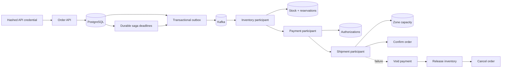

# Architecture decisions

## Saga flow

## ADR-001: The order is the saga state machine

The aggregate permits only explicit forward transitions and records external reservation references needed for compensating actions. Optimistic locking rejects racing updates instead of silently overwriting saga progress.

## ADR-002: Order acceptance and event publication are atomic

The order and initial `RESERVE_INVENTORY` command commit in one PostgreSQL transaction. Horizontally scaled relay workers lease unpublished rows with `FOR UPDATE SKIP LOCKED` and publish with an idempotent Kafka producer. Delivery is at least once, so every participant deduplicates commands and replies by message identity.

## ADR-003: Idempotency is merchant-scoped and payload-aware

The `(merchant_id, client_order_id)` database constraint makes concurrent client retries safe without preventing two merchants from using the same order reference. Each accepted request also stores a canonical SHA-256 fingerprint of merchant, client order ID, normalized decimal amount, and upper-cased currency. Exact retries return the original order; reuse with a different logical payload returns `409 IDEMPOTENCY_CONFLICT`. The database remains the concurrency authority.

The fingerprint is not a security primitive or a substitute for retaining business fields. It is a compact equality check that avoids storing a second serialized request representation. Legacy rows with no fingerprint remain replayable during rolling deployment; all new rows receive a fingerprint.

## ADR-004: Inbox, state transition, and next command commit together

Every participant reply has a globally unique message ID. The coordinator checks the PostgreSQL inbox, applies the aggregate transition, writes the next command to the outbox, and records the inbox row in one transaction. A broker redelivery becomes a no-op, while a crash before commit leaves all three changes absent and safe to retry. Out-of-order replies violate the aggregate state machine and are not acknowledged.

## ADR-005: Compensation mirrors completed work in reverse

The saga retains inventory, payment, and shipment references on the order. If shipment reservation fails after payment authorization, the coordinator first emits `VOID_PAYMENT`; only its successful reply triggers `RELEASE_INVENTORY`, and only the inventory release reply transitions the order to `CANCELLED`. This makes incomplete compensation visible rather than falsely reporting a completed cancellation.

## ADR-006: Integration tests exercise production PostgreSQL semantics

Repository tests run against PostgreSQL 16 with Testcontainers rather than an in-memory substitute. They apply the complete Flyway history and verify the unique order key and inbox primary key at the database boundary. The suite skips only when a developer machine has no container runtime; CI is expected to provide Docker.

## ADR-007: Inventory owns stock and reservations

The inventory participant is the sole writer of inventory counters. It acquires a pessimistic lock on one SKU row, checks availability, updates available and reserved quantities, writes an immutable reservation, records the Kafka command receipt, and emits the saga reply through the outbox in one transaction. This prevents overselling when several orders reserve the last units concurrently.

Release is driven from the stored reservation rather than trusting quantities in a message. Once a reservation is `RELEASED`, replaying the command emits the same successful outcome without changing stock again. A unique reservation per order and a command-receipt primary key provide separate business and transport idempotency barriers.

## ADR-008: Outbox destinations are durable routing intent

Each outbox row stores a logical destination (`LIFECYCLE`, `INVENTORY_COMMANDS`, `PAYMENT_COMMANDS`, `SHIPMENT_COMMANDS`, or `SAGA_REPLIES`). The relay maps those values to configurable Kafka topics. Persisting routing intent with the payload prevents a restart or configuration branch from publishing a committed participant reply to the wrong topic.

## ADR-009: Payment authorizations are durable saga resources

The payment participant persists one authorization per order and a separate receipt for every processed Kafka command. Authorization creation, receipt recording, and the saga reply are atomic. A configurable authorization limit provides deterministic success and decline behavior without coupling this portfolio project to proprietary payment APIs.

Compensation locks the authorization row and changes it from `AUTHORIZED` to `VOIDED`; it never deletes financial history. Replaying a void is safe, while optimistic versioning and the row lock prevent two workers from racing the state change. This models the boundaries a real provider adapter would retain while keeping provider-specific credentials and code outside the repository.

## ADR-010: Shipment capacity is reserved under lock

The shipment participant owns per-zone capacity and reservations. It pessimistically locks the zone row before consuming a slot, then stores the reservation, command receipt, and saga reply in the same transaction. A unique reservation per order provides business idempotency even when the same logical command arrives with a new message ID.

Capacity rejection is a business outcome, not an infrastructure failure. The participant returns `SHIPMENT_REJECTED`; the coordinator then voids payment and releases inventory in reverse acquisition order. This keeps resource ownership explicit and prevents the order from appearing cancelled before compensation has actually completed.

## ADR-011: Timeouts are durable workflow state

Each active order has one saga-deadline row containing the current command payload, logical destination, attempt count, and next-attempt time. The order transition, next command, and deadline replacement commit together. Workers lease due rows with `FOR UPDATE SKIP LOCKED`, allowing horizontal scaling without two workers retrying the same deadline concurrently.

Retries reuse the original command message ID. This is safe because each participant atomically stores both its command receipt and outgoing reply; if participant work committed, its reply remains recoverable from that participant's outbox. If work never committed, the same command can be processed normally. Exponential backoff prevents a degraded dependency from receiving a tight retry loop.

Forward-stage exhaustion becomes a synthetic participant rejection and follows the normal compensation state machine. Compensation-stage exhaustion emits `COMPENSATION_STALLED` and deliberately leaves the order non-terminal. The system therefore prefers visible manual intervention over falsely claiming that payment or inventory was released.

## ADR-012: Authentication establishes tenant identity

The API never accepts merchant identity as an authority-bearing request field. It hashes the supplied API key, loads only active credentials, verifies the digest in constant time, and creates a stateless Spring Security identity with explicit read/write scopes. Only hashes are persisted; raw keys belong in the caller and a production secret manager.

Every order read includes both order ID and authenticated merchant ID. A caller therefore receives the same not-found response for a nonexistent order and another merchant's order, avoiding cross-tenant data disclosure. Health and OpenAPI documentation remain public, while all `/v1` operations require authentication and endpoint-specific scope authorization.

## ADR-013: Workflow metrics use bounded dimensions

Micrometer counters expose order-request outcomes, saga reply outcomes, deadline retries and exhaustion, and outbox publications. Labels are limited to enumerated workflow types, stages, destinations, and outcomes. Order IDs, merchant IDs, message IDs, and correlation IDs are deliberately excluded to prevent unbounded Prometheus series growth.

Prometheus alerts distinguish application availability, HTTP server-error pressure, and exhausted workflow retry budgets. This makes a business failure such as stuck fulfillment visible even when the JVM and HTTP health endpoint remain technically available.

HTTP requests carry a sanitized `X-Correlation-Id` in the response and logging MDC. Caller-provided IDs are accepted only from a conservative character set and length; unsafe values are replaced with UUIDs to avoid log injection and oversized diagnostic fields.

## ADR-014: Trace context crosses asynchronous saga boundaries

Spring observations create HTTP server spans and Kafka producer/consumer spans. W3C trace context is injected into Kafka headers, so a saga that leaves the request thread remains connected across inventory, payment, shipment, retries, and compensation. OTLP keeps the application independent of a specific trace backend; Docker Compose uses Jaeger while an AWS deployment can route the same signals through an OpenTelemetry Collector.

Trace and span IDs are placed in the structured logging context alongside the sanitized request correlation ID. Metrics remain the alerting signal, traces explain distributed latency and causality, and logs provide detailed evidence. Sampling is configurable because retaining every production trace would add unnecessary cost at high order volume.

## ADR-015: Dashboards are versioned with the service

The Grafana data source and dashboard are provisioned from repository files rather than configured manually. Dashboard panels use the same bounded-cardinality metrics that drive alerts and cover both workflow health (request outcomes, saga replies, retry exhaustion, and outbox throughput) and platform health (HTTP latency/errors and JVM heap).

Keeping the dashboard beside the application makes operational expectations reviewable in pull requests and reproducible in every environment. The local anonymous viewer is a development convenience; production deployments must use identity-aware access and should import the versioned dashboard through infrastructure automation.

## ADR-016: Performance gates test business correctness

The k6 suite measures latency and transport failures, but it also verifies an order-specific invariant: an exact idempotent replay must return the same order ID. A second scenario races multiple clients against shared request keys to exercise PostgreSQL uniqueness under contention. This prevents a fast but logically incorrect service from passing the performance gate.

Thresholds define an explicit local baseline: under the supplied workload, HTTP failures stay below 1%, p95 stays below 500 ms, p99 stays below one second, logical success exceeds 99%, and replay mismatches remain zero. The repository treats these as acceptance criteria to measure in a real environment, not fabricated benchmark results.

## ADR-017: Deployments drain before termination

Spring graceful shutdown, a pre-stop delay, readiness probes, and a larger Kubernetes termination budget work together so a rolling update stops new HTTP traffic before the JVM exits. Kafka handlers and transactional workers retain database-backed retry safety if a pod still terminates mid-operation.

Three baseline replicas, topology spreading, a disruption budget, and zero-unavailable rolling updates protect availability during deploys and voluntary node maintenance. HPA scale-down stabilization reduces oscillation. Secrets remain outside images and ConfigMaps, while the service-account annotation provides an IRSA integration point for least-privilege AWS access.

## ADR-018: Releases carry verifiable supply-chain evidence

Version tags are the only release trigger. Each release reruns verification, publishes an immutable container, records a JAR checksum, generates an SPDX SBOM, and creates a GitHub build-provenance attestation bound to the image digest. Deployments can therefore identify the exact reviewed source and dependency inventory behind an artifact.

CodeQL and Trivy run independently of the functional test workflow, while Dependabot proposes bounded weekly dependency updates. These controls reduce risk but do not replace review, least-privilege runtime configuration, secret rotation, or incident response.

## Project status

Version 1.0.0 completes the planned functional saga, failure recovery, security, testing, observability, performance, deployment, and supply-chain scope. Future work should be driven by measured production requirements rather than portfolio feature accumulation.
